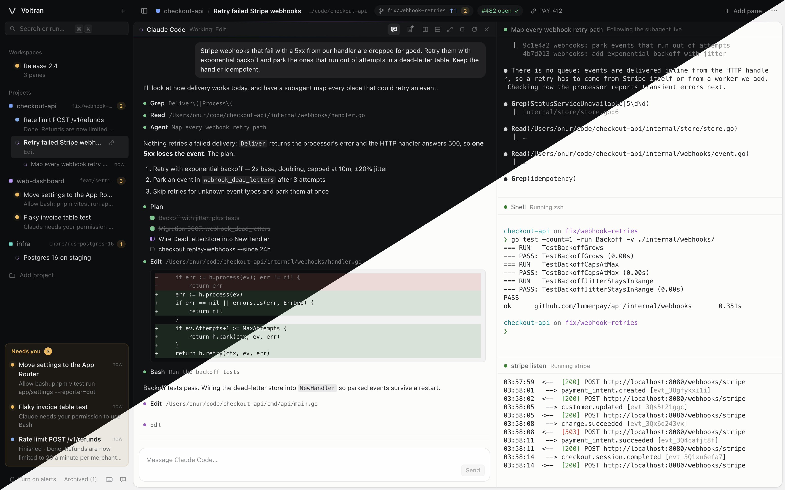

<p align="center">
  
</p>

## Voltran

A local control room for running many coding agents and terminals at once. Instead of a dozen
terminal windows, you get one window with your projects, a session per piece of work, and split
panes for the agents, shells and dev servers in it. Voltran tells you which agent is waiting on you.

It works with any folder and any agent CLI. Claude Code gets first-class status through its hooks,
including the subagents it runs, OpenCode through a plugin Voltran gives it, and Codex through hooks
you trust once; other agents (Antigravity, anything else) get status from terminal activity.

<p align="center">
  
</p>

## Requirements

- macOS or Linux (see [On Linux](#on-linux)). Windows is not supported; run Voltran inside WSL2,
  which is Linux
- Node.js 22.18 or newer (Voltran runs its TypeScript directly, with no build step for the daemon)
- Google Chrome is optional: when installed, `voltran up` opens Voltran in its own app window

## Getting started

```bash
brew install onurravli/tap/voltran
voltran up
```

Or with npm:

```bash
npm install -g --allow-scripts=voltran,node-pty voltran
voltran up
```

npm 11 skips the install scripts of a global package unless you allow them, and Voltran needs both:
node-pty's compiles its terminal support on Linux, and Voltran's makes node-pty's macOS helper
executable.

Or run it from a clone, which is what you want for working on Voltran itself:

```bash
git clone https://github.com/onurravli/voltran.git
cd voltran
npm install
npm link            # optional: puts `voltran` on your PATH
voltran up          # or: npm run up
```

`voltran up` starts the daemon in the background and opens a signed-in window (from a clone, it
builds the UI first). Closing the window stops nothing; run `voltran up` again to reopen it. When a Voltran window
is already open, `voltran up` does not open another one.

| Command | What it does |
|---|---|
| `voltran up [--browser] [--no-open] [--new]` | Start the daemon if needed and open the UI, unless a Voltran window is already open (`--new` opens another anyway) |
| `voltran add [path] [--name <name>]` | Register a folder as a project (defaults to the current folder) |
| `voltran new [path] [--pane <pane>]… [--title <title>] [--worktree <branch>[:<base>]]` | Open a session in a folder (the current one by default), registering it as a project if it is not one yet, and show it in the window. Each `--pane` adds a pane in order: `claude`, `codex`, `opencode`, `antigravity` or `shell`, followed by arguments for that agent, `command` followed by a command to run, `preview` followed by a page on this computer (`localhost:5173`), or `changes` for the git changes of the folder. Without `--pane` the session starts with one Claude Code pane. Prints the session's id; `--no-open` leaves the window alone |
| `voltran status` | Show the daemon and every pane that needs you |
| `voltran down` | Stop the daemon. Agents resume the next time you open them |
| `voltran restart` | Restart the daemon so it loads new code, then reconnect the open windows. Takes the same options as `up` |
| `voltran autostart [on\|off]` | Start the daemon when you log in (a LaunchAgent on macOS, a systemd user service on Linux); with no argument, say whether it does |
| `voltran signout` | Sign out every window and replace the token. `voltran up` signs this computer in again |
| `voltran doctor [--report]` | Check the installation: Node, terminals, the daemon, the agents it finds, git and the browser. `--report` opens a bug report with the results filled in |
| `voltran version` | Print the installed version (`--version` and `-v` work too) |

### In the Dock

In Chrome, ⌘K → **Install Voltran as an app** installs Voltran as an app of its own: it gets its own
window, Dock icon and ⌘Tab entry, and `voltran up` opens it from then on. Right-click its Dock icon →
Options → Keep in Dock to pin it. The app cannot start the daemon, so run `voltran autostart on` once
to have it running whenever you are logged in. The agent runs the Node that ran that command; run it
again after switching Node versions.

### On Linux

Voltran runs the same way on Linux, with these differences:

- `npm install` compiles node-pty, which has no prebuilt binary for Linux, so it needs Python 3, make
  and a C++ compiler (`build-essential` and `python3` on Debian and Ubuntu).
- `voltran up` opens an app window with the first of `google-chrome`, `google-chrome-stable`,
  `chromium` or `chromium-browser` on your `PATH`, or the default browser through `xdg-open`. It does
  not find an installed Chrome app, so it opens a window of its own even after you install one.
- `voltran autostart on` writes `~/.config/systemd/user/voltran.service` and enables it, so it needs a
  systemd user session. To keep Voltran running while you are logged out, run
  `loginctl enable-linger`.
- The shortcuts that use ⌘ on a Mac use Ctrl+Shift: Ctrl+Shift+K opens the command palette and
  Ctrl+Shift+F finds in the terminal, with F3 / Shift+F3 for the next and previous match. The ⌃⌥
  shortcuts are Ctrl+Alt. GNOME keeps Ctrl+Alt+arrows for switching workspaces, so those four may
  not reach Voltran; their actions are in the command palette too. The ⌘ line-editing keys below are
  macOS only.
- The notes lock relies on file permissions, which do not stop root, so run Voltran as your own
  user.

## How it is organized

- **Project**: a folder or repository you work in.
- **Session**: one piece of work inside a project, such as a ticket, a branch or an investigation.
  It can carry a link to its ticket or pull request, and it can work in a git worktree of its own.
  A session that starts with Claude Code, Codex or OpenCode needs no title: it is called "New
  session" until your first prompt, which names it, and a Claude Code session then takes the title
  Claude gives the conversation. Renaming it yourself keeps your title.
- **Pane**: a terminal inside a session, which runs an agent (Claude Code, OpenCode, Codex,
  Antigravity), a shell, or a command such as `npm run dev`. Panes split right or down and resize freely. A
  command that starts with `claude`, such as `claude --plugin-dir ./my-plugin`, opens a Claude Code
  pane with those arguments, so it keeps its status, subagents and resume. Quotes work as in a shell
  but nothing is expanded (`~`, `$VAR`), and Voltran sets `--settings`, `--session-id`, `--resume`
  and `--continue` itself. A command that starts with `opencode`, such as `opencode --auto` or
  `opencode mini --model anthropic/claude-sonnet-4-5`, does the same for OpenCode; Voltran sets
  `--standalone`, `--server`, `--session`, `--continue` and `--fork` there.
- **Workspace**: a named screen that shows panes from any projects side by side, such as two agents
  from one repository next to the dev server of another. It only points at the panes: they keep
  running in their own sessions and show there too.

### Arranging panes

Drag a pane by its title bar onto an edge of another pane to move it to that side, onto its middle
to swap the two, or onto another session of the same project in the sidebar to move it into that
session. Moving a pane only changes the layout: its process, scrollback and agent conversation carry
on. ⌃⌥↩ maximizes a pane, ⌃⌥B hides the sidebar, and zen mode (⌃⌥Z) shows the focused pane alone in
full screen. Drag the sidebar's right edge to make it between 200 and 480 pixels wide, or all the way
to the left to close it; double-click the edge to go back to the default width.

Drag a project by its name, or a session, to put it somewhere else in the sidebar: a line shows where
it lands. A session stays in its own project, and a new one starts at the bottom. Every window shows
the same order.

### Sidebar menus

Right-click anything in the sidebar for what you can do with it, or focus it and press Shift+F10
(or the menu key). A project offers a new session (in a worktree, for a repository), its colour,
copying its path, and moving it up or down. A session offers a new pane, its link, copying its path
or worktree branch, adding its panes to a workspace, marking finished panes as seen, moving it up or
down within its project, and archiving. A pane, in a
session's pane list or under **Needs you**, offers showing, maximizing, its notes, restarting or
stopping it, moving it to another session of its project, adding it to a workspace, and closing
it. Right-click empty space for a new session, project or workspace. The ⋯ menus in the sidebar and
the session and workspace headers offer the same actions.

### Workspaces

The **+** next to **Workspaces** at the top of the sidebar starts one; double-click it to rename it.
Drag a session from the sidebar onto it to add every pane that session has, in the session's own
arrangement, or open a session's pane list with the arrow at the end of its row and drag a single
pane. Drop onto the empty workspace, onto an edge of a pane already in it, or onto the workspace's
row in the sidebar; a pane title bar can be dragged onto that row too. Inside a workspace, panes
rearrange the same way as in a session, each title bar names the project and session the pane
belongs to (click it to open that session), and ⌃⌥\ / ⌃⌥- add the new shell to the focused pane's
session and to the workspace. ⌃⌥W or the × takes a pane out of the workspace without stopping it. A
workspace shows at most 16 panes. A pane whose session is archived keeps its place but stays asleep
until the session is restored, and a pane that is closed leaves every workspace it was in. Deleting
a workspace stops nothing.

### Git

A session in a git repository shows its branch in the header, with the commits to push (↑) and pull
(↓) and the number of changed files (●); hover it for staged, unstaged, untracked and conflicting
files. A detached head shows its commit. When the GitHub CLI (`gh`) is installed and signed in, the
branch's pull request appears next to it with its state and checks, and opens on click; set
`git.pullRequests` to `false` to stop asking GitHub. The project's row in the sidebar shows the
branch too. Voltran reads the status every 10 seconds while a window is open, and a second after a
Claude Code or OpenCode pane uses a tool, so an agent's edits show up straight away. It runs
`git status` with `core.fsmonitor` and the repository's own filters off, without optional locks and
without looking inside submodules, so it neither runs a command a repository or a submodule
configures nor holds `index.lock` while an agent commits. A submodule counts as changed when it
points at another commit, not when its own files change.

Click the number of changed files, or press ⌃⌥G, to see the changes in Voltran: every changed file
of the repository on the left, and the selected file against the last commit on the right, in the
editor VS Code uses (Monaco), side by side when there is room, with syntax highlighting, unchanged
stretches folded away and ⌘F to search. ↑ and ↓ (or j and k) move between files and Esc closes it.
The view reads the changes again as agents work. To keep it open next to an agent, use the split
button in its bar, or add a **Changes** pane from a pane's split menu (or `--pane changes`); the
pane shows the changes of its own session's folder. Voltran reads the last commit's side with
`git cat-file`, which runs none of the repository's filters or textconv drivers, and the file on
disk without following links; binary files and files over 512 KB are not shown.

### Worktrees

In a git repository, **Work in its own worktree** in the new session dialog gives the session a
folder and a branch of its own, so agents in different sessions of one repository never touch each
other's files. The branch is named after the session (edit it before starting) and starts from the
branch you pick, the current one by default; an existing branch that is not checked out elsewhere is
checked out as it is. The worktree lives in `~/.voltran/worktrees/<project>/<branch>`, outside your
repository, and when the project is a subfolder of the repository, the session works in the same
subfolder of the worktree. The dialog remembers the choice per project. A worktree session shows its
branch under its name in the sidebar.

Files that git does not track, such as `.env` or `node_modules`, are not copied into the worktree.

Deleting the session removes its worktree when it has no uncommitted or untracked files and no
checked-out submodule, whose own changes Voltran does not look at; otherwise Voltran asks whether to keep the worktree or delete it with the changes. The branch stays either way.
Removing a project removes the worktrees of its sessions that have nothing uncommitted and leaves
the others.

### Status

| Lamp | Meaning |
|---|---|
| Pulsing amber | Needs input: a permission prompt, a question, or a startup prompt such as folder trust |
| Blue | Finished a turn you have not looked at yet |
| Spinning violet | Working |
| Green | A shell or command is running |
| Hollow | Idle |
| Dashed | Asleep: not started yet, or parked after a restart; it starts when you open it |
| Red | Exited with an error |

Panes that need you collect in the **Needs you** tray at the bottom of the sidebar, in the tab title,
and as desktop notifications once you turn alerts on. While any agent in a project is working, a
light sweeps along the line in the project's colour under the session's title bar.

### Usage limits

With a Claude Pro or Max login, the bottom of the sidebar shows how much of your five-hour and weekly
limits is used and how long until each resets. A bar turns amber past half and red past four fifths.
The bars appear once a Claude Code pane has had a reply and update whenever a Claude pane redraws its
status line; after a restart they stay hidden until then.

### Subagents

The subagents a Claude Code pane is running, background ones included, are listed under its session
in the sidebar with how long they have been running. Click one to open it in a pane next to its
Claude pane: a read-only view laid out like Claude Code's own view of a subagent, with its prompt, its
tool calls and their results, and its final report. It follows the subagent live and marks when it
has finished.

### Conversation view

A Claude Code pane can also show its conversation as messages instead of a terminal: ⌃⌥C or the
speech-bubble button in its title bar switches between the two. Prompts, Claude's replies (rendered
as markdown), its thinking, its plan, and each tool call with its input, its result and the diff of
an edit appear as Claude writes them, read from the transcript Claude Code keeps for the
conversation. Each finished turn shows the model, how long it took and when it ended.

The box at the bottom types your message into the terminal and presses Enter, so it reaches Claude as
if you had typed it there. The terminal keeps running underneath: when Claude asks for a permission
or a choice, the view says so, and you answer in the terminal.

### Notes

Every pane has notes of its own: ⌃⌥E or the note button in its title bar opens them in a drawer on
the right of the terminal. They save as you type and stay until the pane is closed, across restarts.
A dot on the button means the pane has notes; it turns blue when an agent changed them since you
last looked.

The agent in the pane shares them. Claude Code gets them when a session starts, resumes or compacts,
and again on your next prompt after you change them, and it writes its decisions, progress and next
steps there. OpenCode reads them as instructions and is told when they change. Every pane has their
path in `$VOLTRAN_NOTES`, so another agent or a script can use them too.

While you type, the notes are yours alone: Voltran makes the file and its folder read-only, so no
agent can write them, and Claude is told to wait. The lock lifts three seconds after you stop typing
or when you leave the drawer. While Claude is editing them, the drawer waits for it instead. If a
save is refused anyway, for example because the notes are open in another window, your text stays
and you choose between keeping it and loading the other version.

### Shortcuts

Shortcuts use ⌃⌥ (Control + Option) so they never collide with the terminal. The exceptions are ⌘K
(⌃⌥K works too) and ⌘F, which mean nothing to a terminal. On Linux they use other keys; see
[On Linux](#on-linux).

| Keys | Action |
|---|---|
| ⌘K | Command palette: every action below, plus the appearance, the themes and the terminal font family and size. Type a workspace, session or pane name to jump to it |
| ⌘F | Find in the focused terminal's scrollback. ↩ / ⇧↩ or ⌘G / ⇧⌘G step through the matches, Esc closes. A capital letter makes it case-sensitive |
| ⌃⌥J | Jump to the next pane that needs you |
| ⌃⌥B | Show or hide the sidebar |
| ⌃⌥Z | Zen mode: the focused pane alone, full screen. Esc still reaches the terminal; ⇧Esc or ⌃⌥Z leaves |
| ⌃⌥N | Start a new session |
| ⌃⌥↑ / ⌃⌥↓ | Previous / next workspace or session |
| ⌃⌥← / ⌃⌥→ | Previous / next pane on screen (moves the maximized view along when a pane is maximized) |
| ⌃⌥\ / ⌃⌥- | Split the focused pane right / down with a shell |
| ⌃⌥↩ | Maximize or restore the focused pane |
| ⌃⌥W | Close the focused pane; in a workspace, take it out of the workspace |
| ⌃⌥C | Switch the focused Claude Code pane between its conversation and its terminal |
| ⌃⌥E | Show or hide the notes of the focused pane |
| ⌃⌥G | Show or hide the git changes of the focused session |
| ⌃⌥/ | Show all shortcuts |

In terminals, Option types the characters of your keyboard layout (such as @ and { on Turkish Q), as
in iTerm's default. Line editing follows iTerm's Natural Text Editing: ⌘←/⌘→ jump to the start or end
of the line, ⌥←/⌥→ move by word, ⌘⌫/⌥⌫ delete the line or the word, and ⇧↩ or ⌥↩ adds a new line.
When a program takes the mouse, as Claude Code's fullscreen mode does, dragging goes to that
program; Option-drag selects the terminal's text anyway.

### Themes and fonts

⌘K → **Appearance…** follows the system's dark or light mode, or keeps one of them. Dark and light
each have their own theme, which colours the whole app and every terminal: ⌘K → **Dark theme…** picks
from Voltran (the default), Tokyo Night, Catppuccin Mocha, Dracula, Nord, Gruvbox Dark, One Dark,
Rosé Pine, Solarized Dark, Kanagawa, Everforest Dark and the Halloween trio Pumpkin Spice, Witching Hour
and Ghost Pepper, and ⌘K → **Light theme…** from Voltran Light (the default), Catppuccin Latte,
Solarized Light, GitHub Light, Rosé Pine Dawn, Gruvbox Light and Candy Corn. ⌘K → **Terminal font family…** lists the common monospace fonts
installed on your Mac or takes any installed font by name, and the terminal font size commands make
terminal text bigger or smaller. ⌘K → **UI font family…** and the UI font size commands do the same
for the rest of the window (sidebar, bars, dialogs), from 11 to 18 pixels; the UI uses the system font
until you pick another. Moving
through a list previews each choice, ↩ keeps it and Esc goes back. Status lamps take their colours
from the theme, so the hues above can differ. ⌘K → **Move the sidebar to the right** (or left) puts the
project list on the other side.

### Settings file

Every choice above is saved in `~/.voltran/settings.json`, and you can edit that file instead of
using ⌘K: ⌘K → **Open the settings file** opens it in a terminal editor in a pane next to the focused
one, creating it with every setting and the values each accepts. The editor is `editor.command`, or
`$VISUAL`, then `$EDITOR`, then `vim`; the pane closes when the editor exits cleanly. With no session
open, or with **Open the settings file in the default app**, it opens in your system's editor
instead. The file takes comments and trailing commas, like VS Code's:

```jsonc
{
    "appearance": "system",          // "system", "dark" or "light"
    "theme": { "dark": "voltran", "light": "voltran-light" },
    "terminal": { "fontFamily": "JetBrains Mono", "fontSize": 13 },
    "ui": { "fontFamily": "", "fontSize": 13 }, // "" is the system font
    "sidebar": { "position": "left" }, // "left" or "right"
    "editor": { "command": "" },       // such as "nvim"
    "git": { "pullRequests": true }    // look up each branch's pull request with gh
}
```

Saving the file changes every open window at once, and a choice made in ⌘K is written back into it
without touching your comments. A value Voltran does not accept keeps its default, and the window
says which one and why; while the file is not valid JSON, the last valid settings stay in effect.
The first window to connect after an update moves the choices it had in the browser into the file.

### Reporting a problem

⌘K → **Report a problem…**, or the speech bubble at the bottom of the sidebar, opens a bug report on
GitHub in your browser with Voltran's version and the results of `voltran doctor` filled in. When the
window does not open at all, `voltran doctor --report` does the same from a terminal. The results
name your agents' versions and Voltran's folders, with your home folder written as `~`; they never
include the token, your notes or anything a pane printed. Nothing is sent until you submit the issue,
and Voltran itself sends nothing.

## How it works

```
packages/
  shared/   domain types, wire protocol, layout tree helpers
  daemon/   HTTP + WebSocket server, PTY manager, SQLite store, agent adapters, `voltran` CLI
  web/      React + xterm.js UI (Vite)
```

- **Daemon.** It owns every terminal through `node-pty` and mirrors each one into a headless xterm.
  A browser that attaches gets an exact snapshot of the screen and scrollback, then the live stream,
  so reloading or reopening the window loses nothing. Metadata lives in SQLite (`node:sqlite`) under
  `~/.voltran/`, and scrollback is saved there every 20 seconds and on shutdown, once each terminal
  has caught up with its last output.
- **Restarts.** Stopping the daemon ends the processes (there is no tmux underneath). On the next
  start, panes come back asleep with their scrollback and start when you open them. Claude Code
  panes come back with `claude --resume <session>` and OpenCode panes with
  `opencode --session <session>`, so the conversation continues. Open windows reconnect on their
  own.
- **Updates.** A build records a hash of the UI's source and of the shared protocol code in
  `dist/version.json`. When the UI is rebuilt, open windows offer to reload. When the build and the
  running daemon come from different protocol code, they say whether to rebuild the UI or restart
  the daemon.
- **Terminal sizes.** A window never resizes a terminal by itself: it asks the daemon for the size
  that fits, and the daemon resizes the process and its own copy and marks the resize in the output
  stream. Every window applies it at that mark, so all copies of a terminal stay identical however
  fast panes are opened, closed or zoomed.
- **Several windows.** Every window shows the same panes. Only the focused one asks for sizes, and a
  window asks again when it regains focus, so a background window of a different size shows its
  terminals cut off or with empty space until you switch to it.
- **Claude Code status.** Voltran launches Claude with `--settings` built for that pane, which adds
  hooks for `SessionStart`, `UserPromptSubmit`, `Pre/PostToolUse`, `Notification`, `Stop`,
  `SubagentStart`, `SubagentStop` and `SessionEnd`. The hooks `curl` the daemon with a secret that is
  unique to that pane's process, read from a file only you can read so it never shows up in `ps`.
  Your own and your repositories' Claude settings stay untouched, because settings passed this way
  add to them rather than replacing them.
- **Usage limits.** Claude Code hands the account's usage limits only to its status line, so the
  settings Voltran passes also set one: a script that sends the limits to the daemon with the pane's
  secret, then runs your own status line command with the same input, taken from the project's
  settings or yours the way Claude would. Only the command carries over: your `refreshInterval` and
  `padding` do not apply inside Voltran. A quiet pane reports the limits from its last reply, so the
  daemon keeps the newest view of each window: the one that resets later, or the higher usage within
  the same window.
- **Subagents.** The hooks give each subagent's id, and Claude writes its transcript next to the
  parent session's (`<session>/subagents/agent-<id>.jsonl`). A subagent pane runs a small viewer
  that follows that file; the daemon tells it when the subagent stops.
- **OpenCode status.** Each OpenCode pane runs its own OpenCode server (`--standalone`), and Voltran
  adds a small plugin to it through `OPENCODE_CONFIG_CONTENT`, which adds to your configuration
  files instead of replacing them. The plugin follows OpenCode's events (prompts, tools, permission
  prompts and questions, including a subagent's, and the end of each turn) and reports them to the
  daemon with the pane's secret. Voltran picks the session id, so the pane resumes the same
  conversation, or the one you switched to inside it.
- **Notes.** Each pane's notes are `~/.voltran/notes/<pane>/notes.md`. Claude Code panes get hooks
  that print them into Claude's context and refuse its edits while you type, and permission to read
  and edit their own pane's notes folder without asking, and no other pane's.
  OpenCode panes get them, with a short guide, as instructions. The lock while you type makes the
  file and its folder read-only on disk and expires if the window goes away.
- **Codex status.** Voltran starts Codex with its hooks as `-c` overrides, which add to your own
  hooks. Codex runs a hook only after you trust it: the first Codex pane asks "Hooks need review",
  and **Trust all and continue** lets every later pane report prompts, tools, approval requests
  and the end of each turn. Until then, and when you decline, the pane gets its status from the
  terminal like other agents, and a finished turn reminds you to trust the hooks in `/hooks`. With
  overrides on its command line, Codex runs without its shared background server and says so as a
  startup warning; the hooks need that, since they find their pane through its environment.
- **Other agents.** Status comes from the terminal: streaming output means working, a quiet period
  after work means finished, and a terminal bell means the agent needs input.

### Security

A local server that can start processes is reachable from every web page you open, so the daemon:

- listens on `127.0.0.1` only;
- requires a credential on every API request and WebSocket: the token (`~/.voltran/token`, mode
  0600) from the CLI, or from a browser a credential of its own, signed with the token, which the page
  keeps in its own storage and sends as a header. It sets no cookie, because a browser sends cookies
  to every port of a host;
- signs browsers in through one-time login codes that expire after 60 seconds. A browser's
  credential lapses after 30 days unless the window renews it, which an open window does when it
  loads and every few hours, and `voltran signout` replaces the token, which signs out every window
  and every copy of a credential at once. A credential a development daemon issues works only there;
- sends a Content-Security-Policy that lets the page run only its own scripts, and tells the browser
  not to let other sites embed the page or load any of its files, which would also tell them
  Voltran runs on your computer;
- rejects any `Host` header other than its own, which blocks DNS rebinding;
- rejects any `Origin` other than its own, on HTTP and WebSocket alike;
- accepts agent hooks only with the per-pane secret, never the main token;
- reads a subagent transcript only at the path derived from Claude's own hook data, never from a
  path a client sends, refuses one reached through a symlink, and drops control characters from it
  before the viewer writes it to a terminal;
- never writes, reads or changes the mode of a notes file through a link or hard link an agent
  planted, and gives Claude the notes through the daemon rather than by reading the agent's folder;
- keeps `~/.voltran` at mode 0700 and its files at 0600, and refuses a home another user owns;
- drops control characters from session titles and status lines taken from what agents report, so
  `voltran status` never writes an agent's escape sequence to your terminal.

Child processes do not inherit the environment of a Claude session that launched the daemon
(`CLAUDECODE`, messaging sockets and tokens) or the identity variables of the terminal that launched
it.

None of this walls panes off from each other: everything in a pane runs as you and can read the
token. [SECURITY.md](SECURITY.md) says what Voltran does not protect against and how to report a
vulnerability.

## Development

```bash
npm run dev:daemon   # daemon with --watch, allows the Vite origin
npm run dev:web      # Vite on http://localhost:4774, proxies /api and /ws to the daemon
npm test             # vitest: shared layout, daemon (PTYs, hooks, subagents, server) and web helpers
npm run test:e2e     # builds the UI, then drives it in headless Chrome against a throwaway daemon
npm run typecheck
npm run build        # rebuilds the UI the daemon serves
npm run package      # the npm package in build/npm; publish it with `npm publish ./build/npm`
```

With both dev servers running, `VOLTRAN_DEV=1 voltran up` opens the Vite URL signed in.

Outside the dev servers, the daemon serves the built UI from `packages/web/dist`: after changing the
UI, run `npm run build` and reload the window. After changing the daemon, run `voltran restart`. It
works from a pane inside Voltran too: that pane stops with the others and resumes when you open it.
The restarted daemon keeps the environment of the one before it, so after changing an environment
variable the daemon should see, use `voltran down && voltran up` from a terminal that has it.

`VOLTRAN_HOME` and `VOLTRAN_PORT` point a daemon at another data folder or port, which keeps
experiments away from your real sessions.

## Roadmap

- Session templates
- Sending a prompt to one or many agents, and headless `claude -p` runs streamed into panes
- An agent-to-agent message bus exposed as an MCP server
- A native window (Tauri) with a dock badge and global shortcuts
- Project providers that discover work automatically, for example task folders in a repository

## License

Voltran is licensed under the [Apache License 2.0](LICENSE.md). Forks and redistributions must keep the
[NOTICE](NOTICE) file, which credits Voltran and its author; the license does not grant use of the
Voltran name.
